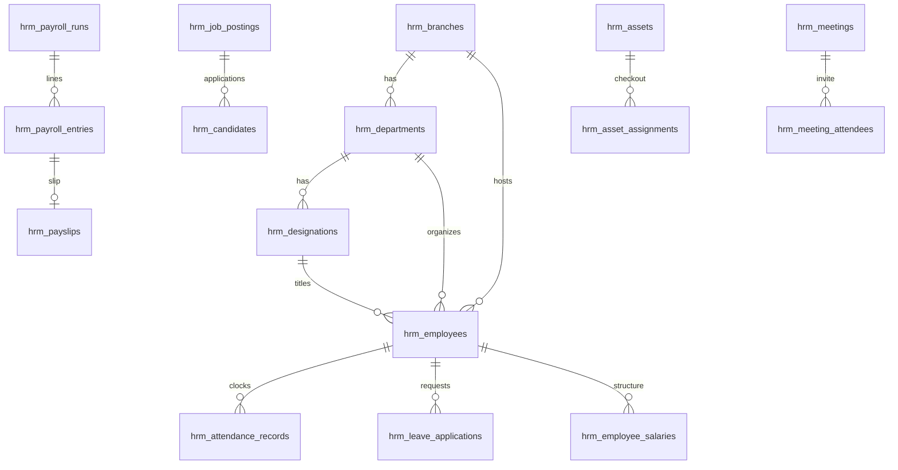

# AgainERP HRM Database Design

**Status:** schema implemented — SQLAlchemy models in `apps/api/app/models/hrm/`; tables created via `Base.metadata.create_all` (`scripts/init_db.py`).

**Sources**
- `d:/localhost/htdocs/erp/hrm_saas/HRM_Functional_and_DB_Reference.docx` (Laravel HRM SaaS schema + behaviour)
- Workdo HRM demo behaviour mirrored in AgainERP admin mocks (`/hrm/*`)
- AgainERP API conventions (`auth_users`, `company_id`, UUID PKs)

**Prefix:** every HRM table is named `hrm_<entity>`.

**Tables documented:** 85 from source + 2 recommended junctions.

---

## 1. Design decisions (AgainERP vs source SaaS)

| Topic | Source SaaS | AgainERP |
|-------|-------------|----------|
| Tenancy | `created_by` as tenant | Explicit `company_id` on every `hrm_*` table |
| Audit | same column | `created_by` / `updated_by` -> `auth_users.id` |
| Primary keys | mostly bigint | `string(36)` UUID |
| Employee foreign keys | often `users.id` | Always `hrm_employees.id` |
| Login account | `employees.user_id` | Optional `hrm_employees.auth_user_id` |
| Employee business code | column named `employee_id` | `hrm_employees.employee_code` |
| Salary component picks | JSON id array | Prefer junction `hrm_employee_salary_components` |
| Holiday branch scope | implied M2M | Add `hrm_holiday_branches` when implementing |

### Shared columns

Unless a table notes otherwise:

```
id          string(36) PK
company_id  string(36) NOT NULL  -- indexed
created_by  string(36) NULL      -- auth_users.id
created_at  timestamptz NOT NULL
updated_at  timestamptz NOT NULL
```

### Approval columns (applications, timesheets, lifecycle, offers, …)

```
status            string
approved_by       string(36) NULL -> auth_users.id
approved_at       timestamptz NULL
rejection_reason  text NULL
```

---

## 2. UI module map

| Nav area | Tables |
|----------|--------|
| Org / employees | `hrm_branches`, `hrm_departments`, `hrm_designations`, `hrm_employees`, documents |
| Attendance / leave | `hrm_shifts`, `hrm_attendance_*`, `hrm_leave_*`, `hrm_time_entries`, `hrm_holidays` |
| Payroll | `hrm_salary_components`, `hrm_employee_salaries`, `hrm_payroll_runs`, `hrm_payroll_entries`, `hrm_payslips` |
| Recruitment | `hrm_job_*`, `hrm_candidates`, interviews, offers, onboarding |
| Performance / training / lifecycle | goals, reviews, trainings, resignations, … |
| Assets / meetings / docs | `hrm_assets*`, `hrm_meeting*`, `hrm_hr_documents*` |

---

## 3. Core ER sketch



---

## 1. Organization & employee master

### `hrm_branches`

| Column | Type | Notes |
|--------|------|-------|
| `id` | string(36) PK | UUID |
| `company_id` | string(36) NOT NULL | Tenant (= auth_users.company_id); indexed |
| `name` | string |  |
| `address` | text | nullable |
| `city` | string | nullable |
| `state` | string | nullable |
| `country` | string | nullable |
| `zip_code` | string | nullable |
| `phone` | string | nullable |
| `email` | string | nullable |
| `status` | string (enum) | active/inactive, default active |
| `created_by` | string(36) NULL | Audit FK -> auth_users.id |
| `created_at` | timestamptz NOT NULL | server default now() |
| `updated_at` | timestamptz NOT NULL | server default now() |

### `hrm_departments`

| Column | Type | Notes |
|--------|------|-------|
| `id` | string(36) PK | UUID |
| `company_id` | string(36) NOT NULL | Tenant (= auth_users.company_id); indexed |
| `name` | string | UNIQUE together with branch_id |
| `branch_id` | string(36) | FK -> hrm_branches.id; cascade |
| `description` | text | nullable |
| `status` | string (enum) | active/inactive, default active |
| `created_by` | string(36) NULL | Audit FK -> auth_users.id |
| `created_at` | timestamptz NOT NULL | server default now() |
| `updated_at` | timestamptz NOT NULL | server default now() |

### `hrm_designations`

| Column | Type | Notes |
|--------|------|-------|
| `id` | string(36) PK | UUID |
| `company_id` | string(36) NOT NULL | Tenant (= auth_users.company_id); indexed |
| `name` | string |  |
| `description` | text | nullable |
| `department_id` | string(36) | FK -> hrm_departments.id; cascade |
| `status` | string (enum) | active/inactive, default active |
| `created_by` | string(36) NULL | Audit FK -> auth_users.id |
| `created_at` | timestamptz NOT NULL | server default now() |
| `updated_at` | timestamptz NOT NULL | server default now() |

### `hrm_document_types`

| Column | Type | Notes |
|--------|------|-------|
| `id` | string(36) PK | UUID |
| `company_id` | string(36) NOT NULL | Tenant (= auth_users.company_id); indexed |
| `name` | string |  |
| `is_required` | boolean | default false |
| `description` | text | nullable |
| `created_by` | string(36) NULL | Audit FK -> auth_users.id |
| `created_at` | timestamptz NOT NULL | server default now() |
| `updated_at` | timestamptz NOT NULL | server default now() |

### `hrm_employees`

| Column | Type | Notes |
|--------|------|-------|
| `id` | string(36) PK | UUID |
| `company_id` | string(36) NOT NULL | Tenant (= auth_users.company_id); indexed |
| `employee_code` | string(64) NOT NULL | Business code EMP######; UNIQUE(company_id, employee_code) |
| `biometric_emp_id` | string | nullable, unique; maps to biometric device emp_code |
| `phone` | string | nullable |
| `date_of_birth` | date | nullable |
| `gender` | string (enum) | male/female/other, nullable |
| `branch_id` | string(36) | FK -> hrm_branches.id; nullable, set null on delete |
| `department_id` | string(36) | FK -> hrm_departments.id; nullable, set null |
| `designation_id` | string(36) | FK -> hrm_designations.id; nullable, set null |
| `shift_id` | string(36) | FK -> hrm_shifts.id; nullable, set null |
| `attendance_policy_id` | string(36) | FK -> hrm_attendance_policies.id; nullable, set null |
| `date_of_joining` | date | nullable |
| `base_salary` | decimal(10,2) | nullable |
| `employment_type` | string | free text e.g. Full-time/Part-time/Contract |
| `employee_status` | string (enum) | active/inactive/terminated/probation, default active |
| `address_line_1` | string | nullable |
| `address_line_2` | string | nullable |
| `city` | string | nullable |
| `state` | string | nullable |
| `country` | string | nullable |
| `postal_code` | string | nullable |
| `emergency_contact_name` | string | nullable |
| `emergency_contact_relationship` | string | nullable |
| `emergency_contact_number` | string | nullable |
| `bank_name` | string | nullable (bank_name required at app layer) |
| `account_holder_name` | string | nullable (bank_name required at app layer) |
| `account_number` | string | nullable (bank_name required at app layer) |
| `bank_identifier_code` | string | nullable (bank_name required at app layer) |
| `bank_branch` | string | nullable (bank_name required at app layer) |
| `tax_payer_id` | string | nullable |
| `auth_user_id` | string(36) NULL | Optional login; UNIQUE; FK -> auth_users.id |
| `created_by` | string(36) NULL | Audit FK -> auth_users.id |
| `created_at` | timestamptz NOT NULL | server default now() |
| `updated_at` | timestamptz NOT NULL | server default now() |

### `hrm_employee_documents`

| Column | Type | Notes |
|--------|------|-------|
| `id` | string(36) PK | UUID |
| `company_id` | string(36) NOT NULL | Tenant (= auth_users.company_id); indexed |
| `employee_id` | string(36) | FK -> hrm_employees.id (cascade) |
| `document_type_id` | string(36) | FK -> hrm_document_types.id; cascade |
| `file_path` | string |  |
| `expiry_date` | date | nullable |
| `verification_status` | string (enum) | pending/verified/rejected, default pending |
| `notes` | text | nullable |
| `created_by` | string(36) NULL | Audit FK -> auth_users.id |
| `created_at` | timestamptz NOT NULL | server default now() |
| `updated_at` | timestamptz NOT NULL | server default now() |

### `hrm_award_types`

| Column | Type | Notes |
|--------|------|-------|
| `id` | string(36) PK | UUID |
| `company_id` | string(36) NOT NULL | Tenant (= auth_users.company_id); indexed |
| `name` | string/text | nullable description |
| `description` | string/text | nullable description |
| `status` | string | default active |
| `created_by` | string(36) NULL | Audit FK -> auth_users.id |
| `created_at` | timestamptz NOT NULL | server default now() |
| `updated_at` | timestamptz NOT NULL | server default now() |

### `hrm_awards`

| Column | Type | Notes |
|--------|------|-------|
| `id` | string(36) PK | UUID |
| `company_id` | string(36) NOT NULL | Tenant (= auth_users.company_id); indexed |
| `employee_id` | string(36) | FK -> hrm_employees.id (cascade) |
| `award_type_id` | string(36) | FK -> hrm_award_types.id; cascade |
| `award_date` | date |  |
| `gift` | string | nullable |
| `monetary_value` | decimal(15,2) | nullable |
| `description` | text | nullable |
| `certificate` | string | nullable file paths |
| `photo` | string | nullable file paths |
| `created_by` | string(36) NULL | Audit FK -> auth_users.id |
| `created_at` | timestamptz NOT NULL | server default now() |
| `updated_at` | timestamptz NOT NULL | server default now() |

### `hrm_ip_restrictions`

| Column | Type | Notes |
|--------|------|-------|
| `id` | string(36) PK | UUID |
| `company_id` | string(36) NOT NULL | Tenant (= auth_users.company_id); indexed |
| `ip_address` | string | unique at app-validation layer only |
| `created_by` | string(36) NULL | Audit FK -> auth_users.id |
| `created_at` | timestamptz NOT NULL | server default now() |
| `updated_at` | timestamptz NOT NULL | server default now() |

---

## 2. Documents & contracts

### `hrm_document_categories`

| Column | Type | Notes |
|--------|------|-------|
| `id` | string(36) PK | UUID |
| `company_id` | string(36) NOT NULL | Tenant (= auth_users.company_id); indexed |
| `name` | string/text | nullable description |
| `description` | string/text | nullable description |
| `color` | string(7) | hex color, default #3B82F6 |
| `icon` | string | default FileText |
| `sort_order` | integer | default 0 |
| `is_mandatory` | boolean | default false |
| `status` | string | default active |
| `created_by` | string(36) NULL | Audit FK -> auth_users.id |
| `created_at` | timestamptz NOT NULL | server default now() |
| `updated_at` | timestamptz NOT NULL | server default now() |

### `hrm_hr_documents`

| Column | Type | Notes |
|--------|------|-------|
| `id` | string(36) PK | UUID |
| `company_id` | string(36) NOT NULL | Tenant (= auth_users.company_id); indexed |
| `title` | string/text | nullable description |
| `description` | string/text | nullable description |
| `category_id` | string(36) | FK -> hrm_document_categories.id; cascade |
| `file_name` | string |  |
| `file_path` | string |  |
| `file_type` | string |  |
| `file_size` | integer |  |
| `version` | string(10) | default 1.0, auto-incremented minor version on replace |
| `status` | string (enum) | Draft/Under Review/Approved/Published/Archived/Expired, default Draft |
| `effective_date` | date | nullable |
| `expiry_date` | date | nullable |
| `requires_acknowledgment` | boolean | default false |
| `download_count` | integer | default 0 |
| `uploaded_by` | string(36) | FK -> auth_users.id (nullable, set null) |
| `approved_by` | string(36) | FK -> auth_users.id (nullable, set null) |
| `approved_at` | timestamp | nullable |
| `created_by` | string(36) NULL | Audit FK -> auth_users.id |
| `created_at` | timestamptz NOT NULL | server default now() |
| `updated_at` | timestamptz NOT NULL | server default now() |

### `hrm_document_acknowledgments`

| Column | Type | Notes |
|--------|------|-------|
| `id` | string(36) PK | UUID |
| `company_id` | string(36) NOT NULL | Tenant (= auth_users.company_id); indexed |
| `document_id` | string(36) | FK -> hrm_hr_documents.id; cascade |
| `user_id` | string(36) | FK -> auth_users.id; cascade |
| `status` | string (enum) | Pending/Acknowledged/Overdue/Exempted, default Pending |
| `acknowledged_at` | timestamp | nullable |
| `due_date` | date | nullable, default +7 days from assignment |
| `acknowledgment_note` | text | nullable |
| `ip_address` | string | nullable, captured on acknowledge |
| `user_agent` | string | nullable, captured on acknowledge |
| `assigned_by` | string(36) | FK -> auth_users.id (nullable, set null) |
| `assigned_at` | timestamp | nullable |
| `created_by` | string(36) NULL | Audit FK -> auth_users.id |
| `created_at` | timestamptz NOT NULL | server default now() |
| `updated_at` | timestamptz NOT NULL | server default now() |

### `hrm_document_templates`

| Column | Type | Notes |
|--------|------|-------|
| `id` | string(36) PK | UUID |
| `company_id` | string(36) NOT NULL | Tenant (= auth_users.company_id); indexed |
| `name` | string/text | nullable description |
| `description` | string/text | nullable description |
| `category_id` | string(36) | FK -> hrm_document_categories.id; cascade |
| `template_content` | longtext |  |
| `placeholders` | json | nullable |
| `default_values` | json | nullable |
| `is_default` | boolean | default false; one default per category per tenant |
| `file_format` | string | default pdf (pdf/doc/docx/txt) |
| `status` | string | default active |
| `created_by` | string(36) NULL | Audit FK -> auth_users.id |
| `created_at` | timestamptz NOT NULL | server default now() |
| `updated_at` | timestamptz NOT NULL | server default now() |

### `hrm_contract_types`

| Column | Type | Notes |
|--------|------|-------|
| `id` | string(36) PK | UUID |
| `company_id` | string(36) NOT NULL | Tenant (= auth_users.company_id); indexed |
| `name` | string |  |
| `description` | text | nullable |
| `default_duration_months` | integer | nullable |
| `probation_period_months` | integer | default 3 (0-12) |
| `notice_period_days` | integer | default 30 (0-365) |
| `is_renewable` | boolean | default true |
| `status` | string | default active |
| `created_by` | string(36) NULL | Audit FK -> auth_users.id |
| `created_at` | timestamptz NOT NULL | server default now() |
| `updated_at` | timestamptz NOT NULL | server default now() |

### `hrm_contract_templates`

| Column | Type | Notes |
|--------|------|-------|
| `id` | string(36) PK | UUID |
| `company_id` | string(36) NOT NULL | Tenant (= auth_users.company_id); indexed |
| `name` | string/text | nullable description |
| `description` | string/text | nullable description |
| `contract_type_id` | string(36) | FK -> hrm_contract_types.id; cascade |
| `template_content` | longtext | {{placeholder}} tokens |
| `variables` | json | nullable |
| `clauses` | json | nullable |
| `is_default` | boolean | default false; one default per contract_type_id per tenant |
| `status` | string | default active |
| `created_by` | string(36) NULL | Audit FK -> auth_users.id |
| `created_at` | timestamptz NOT NULL | server default now() |
| `updated_at` | timestamptz NOT NULL | server default now() |

### `hrm_employee_contracts`

| Column | Type | Notes |
|--------|------|-------|
| `id` | string(36) PK | UUID |
| `company_id` | string(36) NOT NULL | Tenant (= auth_users.company_id); indexed |
| `contract_number` | string | UNIQUE, auto: CON-{creatorId:3}-{seq:4} |
| `employee_id` | string(36) | FK -> hrm_employees.id (cascade) |
| `contract_type_id` | string(36) | FK -> hrm_contract_types.id; cascade |
| `start_date` | date |  |
| `end_date` | date | nullable, must be after start_date |
| `basic_salary` | decimal(10,2) | >=0 |
| `allowances` | json | nullable |
| `benefits` | json | nullable |
| `terms_conditions` | text | nullable |
| `status` | string (enum) | Draft/Pending Approval/Active/Expired/Terminated/Renewed, default Draft |
| `approved_by` | string(36) | FK -> auth_users.id (nullable, set null) |
| `approved_at` | timestamp | nullable |
| `created_by` | string(36) NULL | Audit FK -> auth_users.id |
| `created_at` | timestamptz NOT NULL | server default now() |
| `updated_at` | timestamptz NOT NULL | server default now() |

### `hrm_contract_renewals`

| Column | Type | Notes |
|--------|------|-------|
| `id` | string(36) PK | UUID |
| `company_id` | string(36) NOT NULL | Tenant (= auth_users.company_id); indexed |
| `contract_id` | string(36) | FK -> hrm_employee_contracts.id; cascade |
| `renewal_number` | string | app-generated REN-{creator:3}-{contract:3}-{seq:2} |
| `current_end_date` | date |  |
| `new_start_date` | date |  |
| `new_end_date` | date |  |
| `new_basic_salary` | decimal(10,2) |  |
| `new_allowances` | json | nullable |
| `new_benefits` | json | nullable |
| `new_terms_conditions` | text | nullable |
| `changes_summary` | text | nullable |
| `reason` | text | nullable |
| `status` | string (enum) | Pending/Approved/Rejected/Processed, default Pending |
| `requested_by` | string(36) | FK -> auth_users.id (nullable, set null) |
| `approved_by` | string(36) | FK -> auth_users.id (nullable, set null) |
| `approved_at` | timestamp | nullable |
| `approval_notes` | text | nullable |
| `created_by` | string(36) NULL | Audit FK -> auth_users.id |
| `created_at` | timestamptz NOT NULL | server default now() |
| `updated_at` | timestamptz NOT NULL | server default now() |

---

## 3. Attendance, leave & time

### `hrm_leave_types`

| Column | Type | Notes |
|--------|------|-------|
| `id` | string(36) PK | UUID |
| `company_id` | string(36) NOT NULL | Tenant (= auth_users.company_id); indexed |
| `name` | string/text | nullable description |
| `description` | string/text | nullable description |
| `max_days_per_year` | integer | default 0 |
| `is_paid` | boolean | default true |
| `color` | string(7) | default #3B82F6 |
| `status` | string (enum) | active/inactive, default active |
| `created_by` | string(36) NULL | Audit FK -> auth_users.id |
| `created_at` | timestamptz NOT NULL | server default now() |
| `updated_at` | timestamptz NOT NULL | server default now() |

### `hrm_leave_policies`

| Column | Type | Notes |
|--------|------|-------|
| `id` | string(36) PK | UUID |
| `company_id` | string(36) NOT NULL | Tenant (= auth_users.company_id); indexed |
| `name` | string/text | nullable description |
| `description` | string/text | nullable description |
| `leave_type_id` | string(36) | FK -> hrm_leave_types.id; cascade |
| `accrual_type` | string (enum) | monthly/yearly, default yearly — stored but NOT used by any accrual logic |
| `accrual_rate` | decimal(8,2) | default 0 — stored but unused |
| `carry_forward_limit` | integer | default 0 |
| `min_days_per_application` | integer | default 1 / 30 |
| `max_days_per_application` | integer | default 1 / 30 |
| `requires_approval` | boolean | default true |
| `status` | string (enum) | active/inactive, default active |
| `created_by` | string(36) NULL | Audit FK -> auth_users.id |
| `created_at` | timestamptz NOT NULL | server default now() |
| `updated_at` | timestamptz NOT NULL | server default now() |

### `hrm_leave_applications`

| Column | Type | Notes |
|--------|------|-------|
| `id` | string(36) PK | UUID |
| `company_id` | string(36) NOT NULL | Tenant (= auth_users.company_id); indexed |
| `employee_id` | string(36) | FK -> hrm_employees.id (cascade) |
| `leave_type_id` | string(36) | FK -> hrm_leave_types.id; cascade |
| `leave_policy_id` | string(36) | FK -> hrm_leave_policies.id; cascade |
| `start_date` | date | end >= start |
| `end_date` | date | end >= start |
| `total_days` | integer | inclusive calendar days (no weekend exclusion, no half-day support) |
| `reason` | text |  |
| `attachment` | string | nullable |
| `status` | string (enum) | pending/approved/rejected, default pending |
| `manager_comments` | text | nullable |
| `approved_by` | string(36) | FK -> auth_users.id (nullable, set null) |
| `approved_at` | timestamp | nullable |
| `created_by` | string(36) NULL | Audit FK -> auth_users.id |
| `created_at` | timestamptz NOT NULL | server default now() |
| `updated_at` | timestamptz NOT NULL | server default now() |

### `hrm_leave_balances`

| Column | Type | Notes |
|--------|------|-------|
| `id` | string(36) PK | UUID |
| `company_id` | string(36) NOT NULL | Tenant (= auth_users.company_id); indexed |
| `employee_id` | string(36) | FK -> hrm_employees.id (cascade) |
| `leave_type_id` | string(36) | FK -> hrm_leave_types.id; cascade |
| `leave_policy_id` | string(36) | FK -> hrm_leave_policies.id; cascade |
| `year` | YEAR |  |
| `allocated_days` | decimal(8,2) | default 0 |
| `used_days` | decimal(8,2) | default 0 |
| `remaining_days` | decimal(8,2) | default 0 |
| `carried_forward` | decimal(8,2) | default 0 |
| `manual_adjustment` | decimal(8,2) | default 0 |
| `adjustment_reason` | text | nullable |
| `created_by` | string(36) NULL | Audit FK -> auth_users.id |
| `created_at` | timestamptz NOT NULL | server default now() |
| `updated_at` | timestamptz NOT NULL | server default now() |

### `hrm_shifts`

| Column | Type | Notes |
|--------|------|-------|
| `id` | string(36) PK | UUID |
| `company_id` | string(36) NOT NULL | Tenant (= auth_users.company_id); indexed |
| `name` | string/text | nullable description |
| `description` | string/text | nullable description |
| `start_time` | time |  |
| `end_time` | time |  |
| `break_duration` | integer | minutes, default 0 |
| `break_start_time` | time | nullable |
| `break_end_time` | time | nullable |
| `grace_period` | integer | minutes, default 0 (defined, unused in calc) |
| `is_night_shift` | boolean | default false |
| `status` | string (enum) | active/inactive, default active |
| `created_by` | string(36) NULL | Audit FK -> auth_users.id |
| `created_at` | timestamptz NOT NULL | server default now() |
| `updated_at` | timestamptz NOT NULL | server default now() |

### `hrm_attendance_policies`

| Column | Type | Notes |
|--------|------|-------|
| `id` | string(36) PK | UUID |
| `company_id` | string(36) NOT NULL | Tenant (= auth_users.company_id); indexed |
| `name` | string/text | nullable description |
| `description` | string/text | nullable description |
| `late_arrival_grace` | integer | minutes, default 15/15 |
| `early_departure_grace` | integer | minutes, default 15/15 |
| `half_day_threshold` | decimal(5,2) | hours, default 4.00 (stored, but actual calc uses half of shift hours instead) |
| `overtime_rate_per_hour` | decimal(8,2) | default 150.00 |
| `status` | string (enum) | active/inactive, default active |
| `created_by` | string(36) NULL | Audit FK -> auth_users.id |
| `created_at` | timestamptz NOT NULL | server default now() |
| `updated_at` | timestamptz NOT NULL | server default now() |

### `hrm_attendance_records`

| Column | Type | Notes |
|--------|------|-------|
| `id` | string(36) PK | UUID |
| `company_id` | string(36) NOT NULL | Tenant (= auth_users.company_id); indexed |
| `employee_id` | string(36) | FK -> hrm_employees.id (cascade) |
| `biometric_id` | string | nullable; device transaction id, used to dedupe synced punches |
| `shift_id` | string(36) | FK -> hrm_shifts.id; nullable, set null |
| `attendance_policy_id` | string(36) | FK -> hrm_attendance_policies.id; nullable, set null |
| `date` | date |  |
| `clock_in` | time | nullable |
| `clock_out` | time | nullable |
| `total_hours` | decimal(5,2) | default 0 |
| `break_hours` | decimal(5,2) | default 0 |
| `overtime_hours` | decimal(5,2) | default 0 |
| `overtime_amount` | decimal(8,2) | default 0 |
| `is_late` | boolean | default false |
| `is_early_departure` | boolean | default false |
| `is_absent` | boolean | default false |
| `is_holiday` | boolean | default false |
| `is_weekend` | boolean | default false |
| `status` | string (enum) | present/absent/half_day/on_leave/holiday, default present |
| `notes` | text | nullable |
| `created_by` | string(36) NULL | Audit FK -> auth_users.id |
| `created_at` | timestamptz NOT NULL | server default now() |
| `updated_at` | timestamptz NOT NULL | server default now() |

### `hrm_attendance_regularizations`

| Column | Type | Notes |
|--------|------|-------|
| `id` | string(36) PK | UUID |
| `company_id` | string(36) NOT NULL | Tenant (= auth_users.company_id); indexed |
| `employee_id` | string(36) | FK -> hrm_employees.id (cascade) |
| `attendance_record_id` | string(36) | FK -> hrm_attendance_records.id; cascade |
| `date` | date |  |
| `requested_clock_in` | time | nullable |
| `requested_clock_out` | time | nullable |
| `original_clock_in` | time | nullable; snapshotted at creation |
| `original_clock_out` | time | nullable; snapshotted at creation |
| `reason` | text |  |
| `status` | string (enum) | pending/approved/rejected, default pending |
| `manager_comments` | text | nullable |
| `approved_by` | string(36) | FK -> auth_users.id (nullable, set null) |
| `approved_at` | timestamp | nullable |
| `created_by` | string(36) NULL | Audit FK -> auth_users.id |
| `created_at` | timestamptz NOT NULL | server default now() |
| `updated_at` | timestamptz NOT NULL | server default now() |

### `hrm_time_entries`

| Column | Type | Notes |
|--------|------|-------|
| `id` | string(36) PK | UUID |
| `company_id` | string(36) NOT NULL | Tenant (= auth_users.company_id); indexed |
| `employee_id` | string(36) | FK -> hrm_employees.id (cascade) |
| `date` | date |  |
| `hours` | decimal(5,2) | 0.5–24 |
| `description` | text |  |
| `project` | string | nullable, free text |
| `status` | string (enum) | pending/approved/rejected, default pending |
| `manager_comments` | text | nullable |
| `approved_by` | string(36) | FK -> auth_users.id (nullable, set null) |
| `approved_at` | timestamp | nullable |
| `created_by` | string(36) NULL | Audit FK -> auth_users.id |
| `created_at` | timestamptz NOT NULL | server default now() |
| `updated_at` | timestamptz NOT NULL | server default now() |

### `hrm_holidays`

| Column | Type | Notes |
|--------|------|-------|
| `id` | string(36) PK | UUID |
| `company_id` | string(36) NOT NULL | Tenant (= auth_users.company_id); indexed |
| `name` | string |  |
| `start_date` | date | end nullable, supports multi-day |
| `end_date` | date | end nullable, supports multi-day |
| `category` | string | free text, e.g. national/religious/company/regional |
| `description` | text | nullable |
| `is_recurring` | boolean | default false/true/false |
| `is_paid` | boolean | default false/true/false |
| `is_half_day` | boolean | default false/true/false |
| `created_by` | string(36) NULL | Audit FK -> auth_users.id |
| `created_at` | timestamptz NOT NULL | server default now() |
| `updated_at` | timestamptz NOT NULL | server default now() |

---

## 4. Payroll

### `hrm_salary_components`

| Column | Type | Notes |
|--------|------|-------|
| `id` | string(36) PK | UUID |
| `company_id` | string(36) NOT NULL | Tenant (= auth_users.company_id); indexed |
| `name` | string/text | nullable description; name unique per tenant |
| `description` | string/text | nullable description; name unique per tenant |
| `type` | string (enum) | earning/deduction, default earning |
| `calculation_type` | string (enum) | fixed/percentage, default fixed |
| `default_amount` | decimal(10,2) | used when calculation_type=fixed, default 0 |
| `percentage_of_basic` | decimal(5,2) | used when calculation_type=percentage, nullable |
| `is_taxable` | boolean | default true — informational only, no tax engine consumes it |
| `is_mandatory` | boolean | default false |
| `status` | string (enum) | active/inactive, default active |
| `created_by` | string(36) NULL | Audit FK -> auth_users.id |
| `created_at` | timestamptz NOT NULL | server default now() |
| `updated_at` | timestamptz NOT NULL | server default now() |

### `hrm_employee_salaries`

| Column | Type | Notes |
|--------|------|-------|
| `id` | string(36) PK | UUID |
| `company_id` | string(36) NOT NULL | Tenant (= auth_users.company_id); indexed |
| `employee_id` | string(36) | FK -> hrm_employees.id (cascade) |
| `basic_salary` | decimal(10,2) | nullable; kept in sync with employees.base_salary |
| `components` | json | array of salary_components.id selected for this employee |
| `is_active` | boolean | default true |
| `calculation_status` | string (enum) | pending/calculated, default pending |
| `notes` | text | nullable |
| `created_by` | string(36) NULL | Audit FK -> auth_users.id |
| `created_at` | timestamptz NOT NULL | server default now() |
| `updated_at` | timestamptz NOT NULL | server default now() |

### `hrm_payroll_runs`

| Column | Type | Notes |
|--------|------|-------|
| `id` | string(36) PK | UUID |
| `company_id` | string(36) NOT NULL | Tenant (= auth_users.company_id); indexed |
| `title` | string |  |
| `payroll_frequency` | string (enum) | weekly/biweekly/monthly, default monthly |
| `pay_period_start` | date | pay_date >= period_end |
| `pay_period_end` | date | pay_date >= period_end |
| `pay_date` | date | pay_date >= period_end |
| `total_gross_pay` | decimal(12,2) | default 0, aggregated from entries |
| `total_deductions` | decimal(12,2) | default 0, aggregated from entries |
| `total_net_pay` | decimal(12,2) | default 0, aggregated from entries |
| `employee_count` | integer | default 0 |
| `status` | string (enum) | draft/processing/completed/cancelled, default draft (processing/cancelled never actually set by code) |
| `notes` | text | nullable |
| `created_by` | string(36) NULL | Audit FK -> auth_users.id |
| `created_at` | timestamptz NOT NULL | server default now() |
| `updated_at` | timestamptz NOT NULL | server default now() |

### `hrm_payroll_entries`

| Column | Type | Notes |
|--------|------|-------|
| `id` | string(36) PK | UUID |
| `company_id` | string(36) NOT NULL | Tenant (= auth_users.company_id); indexed |
| `payroll_run_id` | string(36) | FK -> hrm_payroll_runs.id; cascade |
| `employee_id` | string(36) | FK -> hrm_employees.id (cascade) |
| `basic_salary` | decimal(10,2) | default 0 |
| `component_earnings` | decimal(10,2) | = total_earnings − basic_salary |
| `total_earnings` | decimal(10,2) | basic + all earning components |
| `total_deductions` | decimal(10,2) | sum of deduction components only |
| `gross_pay` | decimal(10,2) | = total_earnings − unpaid_leave_deduction + overtime_amount |
| `net_pay` | decimal(10,2) | = gross_pay − total_deductions |
| `overtime_amount` | decimal(10,2) | from attendance records in period |
| `per_day_salary` | decimal(10,2) | = basic_salary / working_days |
| `unpaid_leave_deduction` | decimal(10,2) | = per_day_salary × unpaid_leave_days |
| `working_days` | integer | working days in period per tenant working-day config |
| `present_days` | decimal(5,2) | includes holiday-marked days |
| `full_present_days` | integer | defined but NOT populated by the processor |
| `half_days` | decimal(5,2) |  |
| `holiday_days` | integer |  |
| `paid_leave_days` | decimal(5,2) | from approved leave, split by leave_type.is_paid |
| `unpaid_leave_days` | decimal(5,2) | from approved leave, split by leave_type.is_paid |
| `absent_days` | integer |  |
| `overtime_hours` | decimal(5,2) |  |
| `earnings_breakdown` | json | {component_name: amount} snapshots |
| `deductions_breakdown` | json | {component_name: amount} snapshots |
| `notes` | text | nullable |
| `created_by` | string(36) NULL | Audit FK -> auth_users.id |
| `created_at` | timestamptz NOT NULL | server default now() |
| `updated_at` | timestamptz NOT NULL | server default now() |

### `hrm_payslips`

| Column | Type | Notes |
|--------|------|-------|
| `id` | string(36) PK | UUID |
| `company_id` | string(36) NOT NULL | Tenant (= auth_users.company_id); indexed |
| `payroll_entry_id` | string(36) | FK -> hrm_payroll_entries.id; cascade |
| `employee_id` | string(36) | FK -> hrm_employees.id (cascade) |
| `payslip_number` | string | UNIQUE, format PS-YYYYMM-{4-digit employee id} |
| `pay_period_start` | date |  |
| `pay_period_end` | date |  |
| `pay_date` | date |  |
| `file_path` | string | nullable, PDF path |
| `status` | string (enum) | generated/sent/downloaded, default generated |
| `sent_at` | timestamp | nullable |
| `downloaded_at` | timestamp | nullable |
| `created_by` | string(36) NULL | Audit FK -> auth_users.id |
| `created_at` | timestamptz NOT NULL | server default now() |
| `updated_at` | timestamptz NOT NULL | server default now() |

---

## 5. Recruitment (ATS)

### `hrm_job_categories`

| Column | Type | Notes |
|--------|------|-------|
| `id` | string(36) PK | UUID |
| `company_id` | string(36) NOT NULL | Tenant (= auth_users.company_id); indexed |
| `name` | string/text | nullable description |
| `description` | string/text | nullable description |
| `status` | string | default active |
| `created_by` | string(36) NULL | Audit FK -> auth_users.id |
| `created_at` | timestamptz NOT NULL | server default now() |
| `updated_at` | timestamptz NOT NULL | server default now() |

### `hrm_job_types`

| Column | Type | Notes |
|--------|------|-------|
| `id` | string(36) PK | UUID |
| `company_id` | string(36) NOT NULL | Tenant (= auth_users.company_id); indexed |
| `name` | string/text | nullable |
| `description` | string/text | nullable |
| `status` | string | default active |
| `created_by` | string(36) NULL | Audit FK -> auth_users.id |
| `created_at` | timestamptz NOT NULL | server default now() |
| `updated_at` | timestamptz NOT NULL | server default now() |

### `hrm_job_locations`

| Column | Type | Notes |
|--------|------|-------|
| `id` | string(36) PK | UUID |
| `company_id` | string(36) NOT NULL | Tenant (= auth_users.company_id); indexed |
| `name` | string/text | nullable address |
| `address` | string/text | nullable address |
| `city` | string | nullable |
| `state` | string | nullable |
| `country` | string | nullable |
| `postal_code` | string | nullable |
| `is_remote` | boolean | default false |
| `status` | string | default active |
| `created_by` | string(36) NULL | Audit FK -> auth_users.id |
| `created_at` | timestamptz NOT NULL | server default now() |
| `updated_at` | timestamptz NOT NULL | server default now() |

### `hrm_job_requisitions`

| Column | Type | Notes |
|--------|------|-------|
| `id` | string(36) PK | UUID |
| `company_id` | string(36) NOT NULL | Tenant (= auth_users.company_id); indexed |
| `requisition_code` | string | UNIQUE, auto REQ-{creatorId}-#### |
| `title` | string |  |
| `job_category_id` | string(36) | FK -> hrm_job_categories.id; cascade |
| `department_id` | string(36) | FK -> hrm_departments.id; nullable, set null |
| `positions_count` | integer | default 1 |
| `budget_min` | decimal(15,2) | nullable |
| `budget_max` | decimal(15,2) | nullable |
| `skills_required` | text | nullable |
| `education_required` | text | nullable |
| `experience_required` | text | nullable |
| `description` | text | nullable |
| `responsibilities` | text | nullable |
| `status` | string (enum) | Draft/Pending Approval/Approved/On Hold/Closed, default Draft |
| `approved_by` | string(36) | FK -> auth_users.id (nullable, set null) |
| `approval_date` | timestamp | nullable |
| `priority` | string (enum) | Low/Medium/High, default Medium |
| `created_by` | string(36) NULL | Audit FK -> auth_users.id |
| `created_at` | timestamptz NOT NULL | server default now() |
| `updated_at` | timestamptz NOT NULL | server default now() |

### `hrm_job_postings`

| Column | Type | Notes |
|--------|------|-------|
| `id` | string(36) PK | UUID |
| `company_id` | string(36) NOT NULL | Tenant (= auth_users.company_id); indexed |
| `job_code` | string | UNIQUE, auto JOB-{creatorId}-##### |
| `code` | string | UNIQUE public slug (uniqid) used in careers-page URLs, nullable |
| `title` | string |  |
| `job_type_id` | string(36) | FK -> hrm_job_types.id; cascade |
| `location_id` | string(36) | FK -> hrm_job_locations.id; cascade |
| `branch_id` | string(36) | FK -> hrm_branches.id; nullable, set null |
| `department_id` | string(36) | FK -> hrm_departments.id; nullable, set null |
| `min_experience` | decimal(3,1) | default 0 / nullable |
| `max_experience` | decimal(3,1) | default 0 / nullable |
| `min_salary` | decimal(15,2) | nullable |
| `max_salary` | decimal(15,2) | nullable |
| `description` | text | nullable |
| `requirements` | text | nullable |
| `benefits` | text | nullable |
| `application_deadline` | date | nullable |
| `start_date` | date | nullable |
| `positions` | integer | default 1 |
| `priority` | string (enum) | Low/Medium/High, default Medium |
| `skills` | json | nullable array |
| `applicant` | json | nullable; which optional applicant fields to require (gender, dob, ...) |
| `visibility` | json | nullable; which optional sections to show (cover_letter, terms_and_conditions) |
| `custom_question` | json | nullable array of custom_questions.id attached to this posting |
| `application_type` | string (enum) | existing/custom, default existing |
| `application_url` | string | nullable; used when application_type=custom (external redirect) |
| `is_published` | boolean | default false |
| `publish_date` | timestamp | nullable |
| `is_featured` | boolean | default false |
| `status` | string (enum) | Draft/Published/Closed, default Draft |
| `created_by` | string(36) NULL | Audit FK -> auth_users.id |
| `created_at` | timestamptz NOT NULL | server default now() |
| `updated_at` | timestamptz NOT NULL | server default now() |

### `hrm_candidate_sources`

| Column | Type | Notes |
|--------|------|-------|
| `id` | string(36) PK | UUID |
| `company_id` | string(36) NOT NULL | Tenant (= auth_users.company_id); indexed |
| `name` | string/text | nullable |
| `description` | string/text | nullable |
| `status` | string | default active |
| `created_by` | string(36) NULL | Audit FK -> auth_users.id |
| `created_at` | timestamptz NOT NULL | server default now() |
| `updated_at` | timestamptz NOT NULL | server default now() |

### `hrm_candidates`

| Column | Type | Notes |
|--------|------|-------|
| `id` | string(36) PK | UUID |
| `company_id` | string(36) NOT NULL | Tenant (= auth_users.company_id); indexed |
| `job_id` | string(36) | FK -> hrm_job_postings.id; cascade |
| `source_id` | string(36) | FK -> hrm_candidate_sources.id; cascade |
| `first_name` | string | duplicate (email, job_id) blocked |
| `last_name` | string | duplicate (email, job_id) blocked |
| `email` | string | duplicate (email, job_id) blocked |
| `phone` | string | nullable |
| `current_company` | string | nullable |
| `current_position` | string | nullable |
| `experience_years` | integer | default 0 |
| `current_salary` | decimal(15,2) | nullable; final_salary set on hire |
| `expected_salary` | decimal(15,2) | nullable; final_salary set on hire |
| `final_salary` | decimal(15,2) | nullable; final_salary set on hire |
| `notice_period` | string | nullable |
| `resume_path` | string | required file |
| `cover_letter_path` | string | nullable file |
| `coverletter_message` | text | nullable |
| `skills` | text | nullable |
| `education` | text | nullable |
| `portfolio_url` | string | nullable |
| `linkedin_url` | string | nullable |
| `referral_employee_id` | string(36) | FK -> hrm_employees.id (nullable, set null) |
| `gender` | string (enum) | male/female/other, nullable |
| `date_of_birth` | date | nullable |
| `address` | string | nullable |
| `city` | string | nullable |
| `state` | string | nullable |
| `zip_code` | string | nullable |
| `country` | string | nullable |
| `rating` | integer | nullable |
| `is_archive` | boolean | nullable |
| `is_employee` | boolean | default 0; true once converted |
| `custom_question` | json | nullable; question-text -> answer map |
| `terms_condition_check` | string (enum) | on/off, nullable |
| `branch_id` | string(36) | FK -> branches/departments; nullable, inherited from job posting |
| `department_id` | string(36) | FK -> branches/departments; nullable, inherited from job posting |
| `status` | string (enum) | New/Screening/Interview/Offer/Hired/Rejected, default New |
| `application_date` | date |  |
| `created_by` | string(36) NULL | Audit FK -> auth_users.id |
| `created_at` | timestamptz NOT NULL | server default now() |
| `updated_at` | timestamptz NOT NULL | server default now() |

### `hrm_interview_types`

| Column | Type | Notes |
|--------|------|-------|
| `id` | string(36) PK | UUID |
| `company_id` | string(36) NOT NULL | Tenant (= auth_users.company_id); indexed |
| `name` | string/text | nullable |
| `description` | string/text | nullable |
| `status` | string | default active |
| `created_by` | string(36) NULL | Audit FK -> auth_users.id |
| `created_at` | timestamptz NOT NULL | server default now() |
| `updated_at` | timestamptz NOT NULL | server default now() |

### `hrm_interview_rounds`

| Column | Type | Notes |
|--------|------|-------|
| `id` | string(36) PK | UUID |
| `company_id` | string(36) NOT NULL | Tenant (= auth_users.company_id); indexed |
| `job_id` | string(36) | FK -> hrm_job_postings.id; cascade — rounds are defined per job posting |
| `name` | string |  |
| `sequence_number` | integer | ordering within the job's pipeline |
| `description` | text | nullable |
| `status` | string | default active |
| `created_by` | string(36) NULL | Audit FK -> auth_users.id |
| `created_at` | timestamptz NOT NULL | server default now() |
| `updated_at` | timestamptz NOT NULL | server default now() |

### `hrm_interviews`

| Column | Type | Notes |
|--------|------|-------|
| `id` | string(36) PK | UUID |
| `company_id` | string(36) NOT NULL | Tenant (= auth_users.company_id); indexed |
| `candidate_id` | string(36) | FK -> hrm_candidates.id; cascade |
| `job_id` | string(36) | FK -> hrm_job_postings.id; cascade |
| `round_id` | string(36) | FK -> hrm_interview_rounds.id; cascade |
| `interview_type_id` | string(36) | FK -> hrm_interview_types.id; cascade |
| `scheduled_date` | date/time |  |
| `scheduled_time` | date/time |  |
| `duration` | integer | minutes, default 60 (15-480) |
| `location` | string | nullable |
| `meeting_link` | string | nullable |
| `interviewers` | json | array of user ids |
| `status` | string (enum) | Scheduled/Completed/Cancelled/No-show, default Scheduled |
| `feedback_submitted` | boolean | default false |
| `created_by` | string(36) NULL | Audit FK -> auth_users.id |
| `created_at` | timestamptz NOT NULL | server default now() |
| `updated_at` | timestamptz NOT NULL | server default now() |

### `hrm_interview_feedback`

| Column | Type | Notes |
|--------|------|-------|
| `id` | string(36) PK | UUID |
| `company_id` | string(36) NOT NULL | Tenant (= auth_users.company_id); indexed |
| `interview_id` | string(36) | FK -> hrm_interviews.id; cascade |
| `interviewer_id` | string | nullable — plain string, NOT a real FK; one row per interview+interviewer (app-enforced unique) |
| `technical_rating` | integer | 1-5 scale, nullable |
| `communication_rating` | integer | 1-5 scale, nullable |
| `cultural_fit_rating` | integer | 1-5 scale, nullable |
| `overall_rating` | integer | 1-5 scale, nullable |
| `strengths` | text | nullable |
| `weaknesses` | text | nullable |
| `comments` | text | nullable |
| `recommendation` | string (enum) | Strong Hire/Hire/Maybe/Reject/Strong Reject, nullable |
| `created_by` | string(36) NULL | Audit FK -> auth_users.id |
| `created_at` | timestamptz NOT NULL | server default now() |
| `updated_at` | timestamptz NOT NULL | server default now() |

### `hrm_candidate_assessments`

| Column | Type | Notes |
|--------|------|-------|
| `id` | string(36) PK | UUID |
| `company_id` | string(36) NOT NULL | Tenant (= auth_users.company_id); indexed |
| `candidate_id` | string(36) | FK -> hrm_candidates.id; cascade |
| `assessment_name` | string |  |
| `score` | integer | nullable |
| `max_score` | integer | nullable |
| `pass_fail_status` | string (enum) | Pass/Fail/Pending, default Pending |
| `comments` | text | nullable |
| `conducted_by` | string(36) | FK -> auth_users.id (nullable, set null) |
| `assessment_date` | date |  |
| `created_by` | string(36) NULL | Audit FK -> auth_users.id |
| `created_at` | timestamptz NOT NULL | server default now() |
| `updated_at` | timestamptz NOT NULL | server default now() |

### `hrm_offer_templates`

| Column | Type | Notes |
|--------|------|-------|
| `id` | string(36) PK | UUID |
| `company_id` | string(36) NOT NULL | Tenant (= auth_users.company_id); indexed |
| `name` | string |  |
| `template_content` | longtext | {{placeholder}} tokens |
| `variables` | json | nullable list of placeholder names |
| `status` | string | default active |
| `created_by` | string(36) NULL | Audit FK -> auth_users.id |
| `created_at` | timestamptz NOT NULL | server default now() |
| `updated_at` | timestamptz NOT NULL | server default now() |

### `hrm_offers`

| Column | Type | Notes |
|--------|------|-------|
| `id` | string(36) PK | UUID |
| `company_id` | string(36) NOT NULL | Tenant (= auth_users.company_id); indexed |
| `candidate_id` | string(36) | FK -> hrm_candidates.id; cascade — one offer per (candidate, job) |
| `job_id` | string(36) | FK -> hrm_job_postings.id; cascade |
| `offer_date` | date |  |
| `position` | string |  |
| `department_id` | string(36) | FK -> hrm_departments.id; nullable, set null |
| `salary` | decimal(15,2) |  |
| `bonus` | decimal(15,2) | nullable |
| `equity` | string | nullable |
| `benefits` | text | nullable |
| `start_date` | date |  |
| `expiration_date` | date |  |
| `offer_letter_path` | string | nullable |
| `status` | string (enum) | Draft/Sent/Accepted/Negotiating/Declined/Expired, default Draft |
| `response_date` | date | nullable |
| `decline_reason` | text | nullable |
| `created_by` | string(36) NULL | Audit FK -> auth_users.id |
| `approved_by` | string(36) | FK -> auth_users.id (nullable, set null) |
| `created_at` | timestamptz NOT NULL | server default now() |
| `updated_at` | timestamptz NOT NULL | server default now() |

### `hrm_onboarding_checklists`

| Column | Type | Notes |
|--------|------|-------|
| `id` | string(36) PK | UUID |
| `company_id` | string(36) NOT NULL | Tenant (= auth_users.company_id); indexed |
| `name` | string/text | nullable |
| `description` | string/text | nullable |
| `is_default` | boolean | default false |
| `status` | string | default active |
| `created_by` | string(36) NULL | Audit FK -> auth_users.id |
| `created_at` | timestamptz NOT NULL | server default now() |
| `updated_at` | timestamptz NOT NULL | server default now() |

### `hrm_checklist_items`

| Column | Type | Notes |
|--------|------|-------|
| `id` | string(36) PK | UUID |
| `company_id` | string(36) NOT NULL | Tenant (= auth_users.company_id); indexed |
| `checklist_id` | string(36) | FK -> hrm_onboarding_checklists.id; cascade |
| `task_name` | string/text | nullable description |
| `description` | string/text | nullable description |
| `category` | string (enum) | Documentation/IT Setup/Training/HR/Facilities/Other, default Other |
| `assigned_to_role` | string | nullable |
| `due_day` | integer | default 1 (offset from onboarding start) |
| `is_required` | boolean | default true |
| `status` | string | default active |
| `created_by` | string(36) NULL | Audit FK -> auth_users.id |
| `created_at` | timestamptz NOT NULL | server default now() |
| `updated_at` | timestamptz NOT NULL | server default now() |

### `hrm_candidate_onboarding`

| Column | Type | Notes |
|--------|------|-------|
| `id` | string(36) PK | UUID |
| `company_id` | string(36) NOT NULL | Tenant (= auth_users.company_id); indexed |
| `candidate_id` | unsignedBigInteger | nullable, no FK (legacy — dropped by later migration) |
| `employee_id` | string(36) | FK -> hrm_employees.id (cascade) |
| `checklist_id` | string(36) | FK -> hrm_onboarding_checklists.id; cascade |
| `start_date` | date |  |
| `buddy_employee_id` | string(36) | FK -> hrm_employees.id (nullable, set null) |
| `status` | string (enum) | Pending/In Progress/Completed, default Pending |
| `created_by` | string(36) NULL | Audit FK -> auth_users.id |
| `created_at` | timestamptz NOT NULL | server default now() |
| `updated_at` | timestamptz NOT NULL | server default now() |

### `hrm_custom_questions`

| Column | Type | Notes |
|--------|------|-------|
| `id` | string(36) PK | UUID |
| `company_id` | string(36) NOT NULL | Tenant (= auth_users.company_id); indexed |
| `question` | text |  |
| `required` | boolean | default false |
| `created_by` | string(36) NULL | Audit FK -> auth_users.id |
| `created_at` | timestamptz NOT NULL | server default now() |
| `updated_at` | timestamptz NOT NULL | server default now() |

---

## 6. Performance

### `hrm_performance_indicator_categories`

| Column | Type | Notes |
|--------|------|-------|
| `id` | string(36) PK | UUID |
| `company_id` | string(36) NOT NULL | Tenant (= auth_users.company_id); indexed |
| `name` | string/text | nullable |
| `description` | string/text | nullable |
| `status` | string | default active |
| `created_by` | string(36) NULL | Audit FK -> auth_users.id |
| `created_at` | timestamptz NOT NULL | server default now() |
| `updated_at` | timestamptz NOT NULL | server default now() |

### `hrm_performance_indicators`

| Column | Type | Notes |
|--------|------|-------|
| `id` | string(36) PK | UUID |
| `company_id` | string(36) NOT NULL | Tenant (= auth_users.company_id); indexed |
| `category_id` | string(36) | FK -> hrm_performance_indicator_categories.id; cascade |
| `name` | string/text | nullable |
| `description` | string/text | nullable |
| `measurement_unit` | string | nullable, freeform |
| `target_value` | string | nullable, freeform |
| `status` | string | default active |
| `created_by` | string(36) NULL | Audit FK -> auth_users.id |
| `created_at` | timestamptz NOT NULL | server default now() |
| `updated_at` | timestamptz NOT NULL | server default now() |

### `hrm_goal_types`

| Column | Type | Notes |
|--------|------|-------|
| `id` | string(36) PK | UUID |
| `company_id` | string(36) NOT NULL | Tenant (= auth_users.company_id); indexed |
| `name` | string/text | nullable |
| `description` | string/text | nullable |
| `status` | string | default active |
| `created_by` | string(36) NULL | Audit FK -> auth_users.id |
| `created_at` | timestamptz NOT NULL | server default now() |
| `updated_at` | timestamptz NOT NULL | server default now() |

### `hrm_employee_goals`

| Column | Type | Notes |
|--------|------|-------|
| `id` | string(36) PK | UUID |
| `company_id` | string(36) NOT NULL | Tenant (= auth_users.company_id); indexed |
| `employee_id` | string(36) | FK -> hrm_employees.id (cascade) |
| `goal_type_id` | string(36) | FK -> hrm_goal_types.id; cascade |
| `title` | string/text | nullable description |
| `description` | string/text | nullable description |
| `start_date` | date |  |
| `end_date` | date |  |
| `target` | string | nullable, freeform |
| `progress` | integer | 0-100, default 0 |
| `status` | string | not_started/in_progress/completed, default not_started — auto-derived from progress |
| `created_by` | string(36) NULL | Audit FK -> auth_users.id |
| `created_at` | timestamptz NOT NULL | server default now() |
| `updated_at` | timestamptz NOT NULL | server default now() |

### `hrm_review_cycles`

| Column | Type | Notes |
|--------|------|-------|
| `id` | string(36) PK | UUID |
| `company_id` | string(36) NOT NULL | Tenant (= auth_users.company_id); indexed |
| `name` | string |  |
| `frequency` | string | Monthly/Quarterly/Semi-Annual/Annual |
| `description` | text | nullable |
| `status` | string | default active |
| `created_by` | string(36) NULL | Audit FK -> auth_users.id |
| `created_at` | timestamptz NOT NULL | server default now() |
| `updated_at` | timestamptz NOT NULL | server default now() |

### `hrm_employee_reviews`

| Column | Type | Notes |
|--------|------|-------|
| `id` | string(36) PK | UUID |
| `company_id` | string(36) NOT NULL | Tenant (= auth_users.company_id); indexed |
| `employee_id` | string(36) | FK -> hrm_employees.id (cascade) |
| `reviewer_id` | string(36) | FK -> auth_users.id (nullable, set null) |
| `review_cycle_id` | string(36) | FK -> hrm_review_cycles.id; cascade |
| `review_date` | date | completion_date nullable |
| `completion_date` | date | completion_date nullable |
| `overall_rating` | decimal(3,1) | nullable — computed as average of indicator ratings |
| `comments` | text | nullable |
| `status` | string | scheduled/in_progress/completed, default scheduled — locked once completed |
| `created_by` | string(36) NULL | Audit FK -> auth_users.id |
| `created_at` | timestamptz NOT NULL | server default now() |
| `updated_at` | timestamptz NOT NULL | server default now() |

### `hrm_employee_review_ratings`

| Column | Type | Notes |
|--------|------|-------|
| `id` | string(36) PK | UUID |
| `company_id` | string(36) NOT NULL | Tenant (= auth_users.company_id); indexed |
| `employee_review_id` | string(36) | FK -> hrm_employee_reviews.id; cascade |
| `performance_indicator_id` | string(36) | FK -> hrm_performance_indicators.id; cascade |
| `rating` | decimal(3,1) | 1-5 scale |
| `comments` | text | nullable |
| `created_at` | timestamptz NOT NULL | server default now() |
| `updated_at` | timestamptz NOT NULL | server default now() |

---

## 7. Employee lifecycle

### `hrm_resignations`

| Column | Type | Notes |
|--------|------|-------|
| `id` | string(36) PK | UUID |
| `company_id` | string(36) NOT NULL | Tenant (= auth_users.company_id); indexed |
| `employee_id` | string(36) | FK -> hrm_employees.id (cascade) |
| `resignation_date` | date |  |
| `last_working_day` | date |  |
| `notice_period` | string | nullable |
| `reason` | string | nullable |
| `description` | text | nullable |
| `status` | string | pending/approved/rejected/completed, default pending |
| `documents` | string | nullable path |
| `approved_by` | string(36) | FK -> auth_users.id (nullable, set null) |
| `approved_at` | timestamp | nullable |
| `exit_feedback` | text | nullable |
| `exit_interview_conducted` | boolean | default false |
| `exit_interview_date` | date | nullable |
| `created_by` | string(36) NULL | Audit FK -> auth_users.id |
| `created_at` | timestamptz NOT NULL | server default now() |
| `updated_at` | timestamptz NOT NULL | server default now() |

### `hrm_promotions`

| Column | Type | Notes |
|--------|------|-------|
| `id` | string(36) PK | UUID |
| `company_id` | string(36) NOT NULL | Tenant (= auth_users.company_id); indexed |
| `employee_id` | string(36) | FK -> hrm_employees.id (cascade) |
| `previous_designation` | string | free text snapshot |
| `designation_id` | string(36) | FK -> hrm_designations.id; cascade — the new designation |
| `promotion_date` | date |  |
| `effective_date` | date |  |
| `salary_adjustment` | decimal(15,2) | nullable |
| `reason` | text | nullable |
| `document` | string | nullable path |
| `status` | string (enum) | pending/approved/rejected, default pending |
| `created_by` | string(36) NULL | Audit FK -> auth_users.id |
| `created_at` | timestamptz NOT NULL | server default now() |
| `updated_at` | timestamptz NOT NULL | server default now() |

### `hrm_terminations`

| Column | Type | Notes |
|--------|------|-------|
| `id` | string(36) PK | UUID |
| `company_id` | string(36) NOT NULL | Tenant (= auth_users.company_id); indexed |
| `employee_id` | string(36) | FK -> hrm_employees.id (cascade) |
| `termination_type` | string | voluntary/involuntary/layoff/retirement... |
| `termination_date` | date | notice_date <= termination_date |
| `notice_date` | date | notice_date <= termination_date |
| `notice_period` | string | nullable |
| `reason` | string | nullable |
| `description` | text | nullable |
| `status` | string | planned/'in progress'/completed, default planned |
| `documents` | string | nullable path |
| `approved_by` | string(36) | FK -> auth_users.id (nullable, set null) |
| `approved_at` | timestamp | nullable |
| `exit_interview_conducted` | boolean | default false |
| `exit_interview_date` | date | nullable |
| `exit_feedback` | text | nullable |
| `created_by` | string(36) NULL | Audit FK -> auth_users.id |
| `created_at` | timestamptz NOT NULL | server default now() |
| `updated_at` | timestamptz NOT NULL | server default now() |

### `hrm_warnings`

| Column | Type | Notes |
|--------|------|-------|
| `id` | string(36) PK | UUID |
| `company_id` | string(36) NOT NULL | Tenant (= auth_users.company_id); indexed |
| `employee_id` | string(36) | FK -> hrm_employees.id (cascade) |
| `warning_by` | string(36) | FK -> auth_users.id (nullable, set null) |
| `warning_type` | string | attendance/performance/conduct... |
| `subject` | string |  |
| `severity` | string | verbal/written/final |
| `warning_date` | date |  |
| `description` | text | nullable |
| `status` | string | draft/issued/acknowledged/expired, default draft |
| `documents` | string | nullable path |
| `acknowledgment_date` | date | nullable |
| `employee_response` | text | nullable |
| `approved_by` | string(36) | FK -> auth_users.id (nullable, set null) |
| `approved_at` | timestamp | nullable |
| `expiry_date` | date | nullable |
| `has_improvement_plan` | boolean | default false |
| `improvement_plan_goals` | text | nullable |
| `improvement_plan_progress` | text | nullable |
| `improvement_plan_start_date` | date | nullable |
| `improvement_plan_end_date` | date | nullable |
| `created_by` | string(36) NULL | Audit FK -> auth_users.id |
| `created_at` | timestamptz NOT NULL | server default now() |
| `updated_at` | timestamptz NOT NULL | server default now() |

### `hrm_complaints`

| Column | Type | Notes |
|--------|------|-------|
| `id` | string(36) PK | UUID |
| `company_id` | string(36) NOT NULL | Tenant (= auth_users.company_id); indexed |
| `employee_id` | string(36) | FK -> hrm_employees.id (cascade) |
| `against_employee_id` | string(36) | FK -> hrm_employees.id (nullable, set null) |
| `complaint_type` | string | harassment/discrimination/workplace conditions... |
| `subject` | string |  |
| `complaint_date` | date |  |
| `description` | text | nullable |
| `status` | string | submitted/'under investigation'/resolved/dismissed, default submitted |
| `documents` | string | nullable path |
| `is_anonymous` | boolean | default false |
| `assigned_to` | string(36) | FK -> auth_users.id; nullable — HR handler |
| `resolution_deadline` | date | nullable |
| `investigation_notes` | text | nullable |
| `resolution_action` | text | nullable |
| `follow_up_action` | text | nullable |
| `feedback` | text | nullable |
| `resolution_date` | date | nullable |
| `follow_up_date` | date | nullable |
| `created_by` | string(36) NULL | Audit FK -> auth_users.id |
| `created_at` | timestamptz NOT NULL | server default now() |
| `updated_at` | timestamptz NOT NULL | server default now() |

### `hrm_employee_transfers`

| Column | Type | Notes |
|--------|------|-------|
| `id` | string(36) PK | UUID |
| `company_id` | string(36) NOT NULL | Tenant (= auth_users.company_id); indexed |
| `employee_id` | string(36) | FK -> hrm_employees.id (cascade) |
| `from_branch_id` | string(36) | FK -> hrm_branches.id; nullable |
| `to_branch_id` | string(36) | FK -> hrm_branches.id; nullable |
| `from_department_id` | string(36) | FK -> hrm_departments.id; nullable |
| `to_department_id` | string(36) | FK -> hrm_departments.id; nullable |
| `from_designation_id` | string(36) | FK -> hrm_designations.id; nullable |
| `to_designation_id` | string(36) | FK -> hrm_designations.id; nullable |
| `transfer_date` | date |  |
| `effective_date` | date |  |
| `reason` | text | nullable |
| `notes` | text | nullable |
| `status` | string | pending/approved/rejected, default pending |
| `documents` | string | nullable path |
| `approved_by` | string(36) | FK -> auth_users.id (nullable, set null) |
| `approved_at` | timestamp | nullable |
| `created_by` | string(36) NULL | Audit FK -> auth_users.id |
| `created_at` | timestamptz NOT NULL | server default now() |
| `updated_at` | timestamptz NOT NULL | server default now() |

### `hrm_trips`

| Column | Type | Notes |
|--------|------|-------|
| `id` | string(36) PK | UUID |
| `company_id` | string(36) NOT NULL | Tenant (= auth_users.company_id); indexed |
| `employee_id` | string(36) | FK -> hrm_employees.id (cascade) |
| `purpose` | string |  |
| `destination` | string |  |
| `start_date` | date |  |
| `end_date` | date |  |
| `description` | text | nullable |
| `expected_outcomes` | text | nullable |
| `trip_report` | text | nullable |
| `status` | string | planned/ongoing/completed/cancelled, default planned |
| `documents` | string | nullable path |
| `advance_amount` | decimal(15,2) | nullable |
| `advance_status` | string | nullable; requested/approved/paid/reconciled |
| `total_expenses` | decimal(15,2) | nullable |
| `reimbursement_status` | string | nullable; pending/approved/paid |
| `approved_by` | string(36) | FK -> auth_users.id (nullable, set null) |
| `approved_at` | timestamp | nullable |
| `created_by` | string(36) NULL | Audit FK -> auth_users.id |
| `created_at` | timestamptz NOT NULL | server default now() |
| `updated_at` | timestamptz NOT NULL | server default now() |

### `hrm_trip_expenses`

| Column | Type | Notes |
|--------|------|-------|
| `id` | string(36) PK | UUID |
| `company_id` | string(36) NOT NULL | Tenant (= auth_users.company_id); indexed |
| `trip_id` | string(36) | FK -> hrm_trips.id; cascade |
| `expense_type` | string | transportation/accommodation/meals... |
| `expense_date` | date |  |
| `amount` | decimal(15,2) |  |
| `currency` | string | default USD |
| `description` | text | nullable |
| `receipt` | string | nullable path |
| `is_reimbursable` | boolean | default true |
| `status` | string | pending/approved/rejected, default pending |
| `created_by` | string(36) NULL | Audit FK -> auth_users.id |
| `created_at` | timestamptz NOT NULL | server default now() |
| `updated_at` | timestamptz NOT NULL | server default now() |

---

## 8. Training

### `hrm_training_types`

| Column | Type | Notes |
|--------|------|-------|
| `id` | string(36) PK | UUID |
| `company_id` | string(36) NOT NULL | Tenant (= auth_users.company_id); indexed |
| `name` | string/text | nullable |
| `description` | string/text | nullable |
| `branch_id` | string(36) | FK -> hrm_branches.id; cascade |
| `created_by` | string(36) NULL | Audit FK -> auth_users.id |
| `created_at` | timestamptz NOT NULL | server default now() |
| `updated_at` | timestamptz NOT NULL | server default now() |

### `hrm_training_programs`

| Column | Type | Notes |
|--------|------|-------|
| `id` | string(36) PK | UUID |
| `company_id` | string(36) NOT NULL | Tenant (= auth_users.company_id); indexed |
| `name` | string |  |
| `training_type_id` | string(36) | FK -> hrm_training_types.id; restrict |
| `description` | text | nullable |
| `duration` | integer | hours, nullable |
| `cost` | decimal(15,2) | nullable |
| `capacity` | integer | nullable |
| `status` | string | draft/active/completed/cancelled, default draft |
| `materials` | string | nullable |
| `prerequisites` | text | nullable |
| `is_mandatory` | boolean | default false |
| `is_self_enrollment` | boolean | default false |
| `created_by` | string(36) NULL | Audit FK -> auth_users.id |
| `created_at` | timestamptz NOT NULL | server default now() |
| `updated_at` | timestamptz NOT NULL | server default now() |

### `hrm_training_sessions`

| Column | Type | Notes |
|--------|------|-------|
| `id` | string(36) PK | UUID |
| `company_id` | string(36) NOT NULL | Tenant (= auth_users.company_id); indexed |
| `training_program_id` | string(36) | FK -> hrm_training_programs.id; cascade |
| `name` | string | nullable |
| `start_date` | datetime |  |
| `end_date` | datetime |  |
| `location` | string | nullable |
| `location_type` | string | physical/virtual, default physical |
| `meeting_link` | string | nullable |
| `status` | string | scheduled/in_progress/completed/cancelled, default scheduled |
| `notes` | text | nullable |
| `is_recurring` | boolean | default false |
| `recurrence_pattern` | string | nullable; daily/weekly/monthly |
| `recurrence_count` | integer | nullable |
| `created_by` | string(36) NULL | Audit FK -> auth_users.id |
| `created_at` | timestamptz NOT NULL | server default now() |
| `updated_at` | timestamptz NOT NULL | server default now() |

### `hrm_training_session_attendance`

| Column | Type | Notes |
|--------|------|-------|
| `id` | string(36) PK | UUID |
| `company_id` | string(36) NOT NULL | Tenant (= auth_users.company_id); indexed |
| `training_session_id` | string(36) | FK -> hrm_training_sessions.id; cascade |
| `employee_id` | string(36) | FK -> hrm_employees.id (cascade) |
| `is_present` | boolean | default false |
| `notes` | text | nullable |
| `created_at` | timestamptz NOT NULL | server default now() |
| `updated_at` | timestamptz NOT NULL | server default now() |

### `hrm_employee_trainings`

| Column | Type | Notes |
|--------|------|-------|
| `id` | string(36) PK | UUID |
| `company_id` | string(36) NOT NULL | Tenant (= auth_users.company_id); indexed |
| `employee_id` | string(36) | FK -> hrm_employees.id (cascade) |
| `training_program_id` | string(36) | FK -> hrm_training_programs.id; cascade |
| `status` | string | assigned/in_progress/completed/failed, default assigned |
| `assigned_date` | date | completion_date nullable |
| `completion_date` | date | completion_date nullable |
| `certification` | string | nullable — file path/details |
| `score` | decimal(5,2) | nullable, out of 100 |
| `is_passed` | boolean | nullable |
| `feedback` | text | nullable |
| `notes` | text | nullable |
| `assigned_by` | string(36) | FK -> auth_users.id (nullable, set null) |
| `created_by` | string(36) NULL | Audit FK -> auth_users.id |
| `created_at` | timestamptz NOT NULL | server default now() |
| `updated_at` | timestamptz NOT NULL | server default now() |

### `hrm_training_assessments`

| Column | Type | Notes |
|--------|------|-------|
| `id` | string(36) PK | UUID |
| `company_id` | string(36) NOT NULL | Tenant (= auth_users.company_id); indexed |
| `training_program_id` | string(36) | FK -> hrm_training_programs.id; cascade |
| `name` | string/text | nullable |
| `description` | string/text | nullable |
| `type` | string | quiz/practical/presentation |
| `passing_score` | decimal(5,2) | default 70.00 |
| `criteria` | text | nullable |
| `created_by` | string(36) NULL | Audit FK -> auth_users.id |
| `created_at` | timestamptz NOT NULL | server default now() |
| `updated_at` | timestamptz NOT NULL | server default now() |

### `hrm_employee_assessment_results`

| Column | Type | Notes |
|--------|------|-------|
| `id` | string(36) PK | UUID |
| `company_id` | string(36) NOT NULL | Tenant (= auth_users.company_id); indexed |
| `employee_training_id` | string(36) | FK -> hrm_employee_trainings.id; cascade |
| `training_assessment_id` | string(36) | FK -> hrm_training_assessments.id; cascade |
| `score` | decimal(5,2) |  |
| `is_passed` | boolean |  |
| `feedback` | text | nullable |
| `assessment_date` | date |  |
| `assessed_by` | string(36) | FK -> auth_users.id (nullable, set null) |
| `created_at` | timestamptz NOT NULL | server default now() |
| `updated_at` | timestamptz NOT NULL | server default now() |

---

## 9. Assets

### `hrm_asset_types`

| Column | Type | Notes |
|--------|------|-------|
| `id` | string(36) PK | UUID |
| `company_id` | string(36) NOT NULL | Tenant (= auth_users.company_id); indexed |
| `name` | string/text | nullable |
| `description` | string/text | nullable |
| `created_by` | string(36) NULL | Audit FK -> auth_users.id |
| `created_at` | timestamptz NOT NULL | server default now() |
| `updated_at` | timestamptz NOT NULL | server default now() |

### `hrm_assets`

| Column | Type | Notes |
|--------|------|-------|
| `id` | string(36) PK | UUID |
| `company_id` | string(36) NOT NULL | Tenant (= auth_users.company_id); indexed |
| `name` | string |  |
| `asset_type_id` | string(36) | FK -> hrm_asset_types.id; restrict |
| `serial_number` | string | nullable |
| `asset_code` | string | nullable |
| `purchase_date` | date | nullable |
| `purchase_cost` | decimal(15,2) | nullable |
| `status` | string | available/assigned/under_maintenance/disposed, default available |
| `condition` | string | nullable; new/good/fair/poor |
| `description` | text/string | nullable |
| `location` | text/string | nullable |
| `supplier` | text/string | nullable |
| `warranty_info` | text/string | nullable |
| `warranty_expiry_date` | date | nullable |
| `images` | string | nullable paths |
| `documents` | string | nullable paths |
| `qr_code` | string | nullable paths |
| `created_by` | string(36) NULL | Audit FK -> auth_users.id |
| `created_at` | timestamptz NOT NULL | server default now() |
| `updated_at` | timestamptz NOT NULL | server default now() |

### `hrm_asset_assignments`

| Column | Type | Notes |
|--------|------|-------|
| `id` | string(36) PK | UUID |
| `company_id` | string(36) NOT NULL | Tenant (= auth_users.company_id); indexed |
| `asset_id` | string(36) | FK -> hrm_assets.id; cascade |
| `employee_id` | string(36) | FK -> hrm_employees.id (cascade) |
| `checkout_date` | date | checkin_date nullable = active assignment |
| `checkin_date` | date | checkin_date nullable = active assignment |
| `expected_return_date` | date | checkin_date nullable = active assignment |
| `checkout_condition` | string | nullable |
| `checkin_condition` | string | nullable |
| `notes` | text | nullable |
| `is_acknowledged` | boolean | default false |
| `acknowledged_at` | timestamp | nullable |
| `assigned_by` | string(36) | FK -> auth_users.id (nullable, set null) |
| `received_by` | string(36) | FK -> auth_users.id (nullable, set null) |
| `created_at` | timestamptz NOT NULL | server default now() |
| `updated_at` | timestamptz NOT NULL | server default now() |

### `hrm_asset_maintenances`

| Column | Type | Notes |
|--------|------|-------|
| `id` | string(36) PK | UUID |
| `company_id` | string(36) NOT NULL | Tenant (= auth_users.company_id); indexed |
| `asset_id` | string(36) | FK -> hrm_assets.id; cascade |
| `maintenance_type` | string | repair/preventive/calibration... |
| `start_date` | date | end nullable |
| `end_date` | date | end nullable |
| `cost` | decimal(15,2) | nullable |
| `status` | string | scheduled/in_progress/completed/cancelled, default scheduled |
| `details` | text | nullable |
| `completion_notes` | text | nullable |
| `supplier` | string | nullable |
| `created_by` | string(36) NULL | Audit FK -> auth_users.id |
| `created_at` | timestamptz NOT NULL | server default now() |
| `updated_at` | timestamptz NOT NULL | server default now() |

### `hrm_asset_depreciations`

| Column | Type | Notes |
|--------|------|-------|
| `id` | string(36) PK | UUID |
| `company_id` | string(36) NOT NULL | Tenant (= auth_users.company_id); indexed |
| `asset_id` | string(36) | FK -> hrm_assets.id; cascade — one per asset |
| `method` | string | straight_line/reducing_balance |
| `useful_life_years` | integer | default 5 if unset |
| `salvage_value` | decimal(15,2) | nullable, default 10% of cost if unset |
| `current_value` | decimal(15,2) | initialized to purchase_cost |
| `last_calculated_date` | date |  |
| `created_by` | string(36) NULL | Audit FK -> auth_users.id |
| `created_at` | timestamptz NOT NULL | server default now() |
| `updated_at` | timestamptz NOT NULL | server default now() |

---

## 10. Meetings & announcements

### `hrm_meeting_types`

| Column | Type | Notes |
|--------|------|-------|
| `id` | string(36) PK | UUID |
| `company_id` | string(36) NOT NULL | Tenant (= auth_users.company_id); indexed |
| `name` | string/text | nullable |
| `description` | string/text | nullable |
| `color` | string | default #3B82F6 |
| `default_duration` | integer | minutes, default 60 |
| `status` | string | default active |
| `created_by` | string(36) NULL | Audit FK -> auth_users.id |
| `created_at` | timestamptz NOT NULL | server default now() |
| `updated_at` | timestamptz NOT NULL | server default now() |

### `hrm_meeting_rooms`

| Column | Type | Notes |
|--------|------|-------|
| `id` | string(36) PK | UUID |
| `company_id` | string(36) NOT NULL | Tenant (= auth_users.company_id); indexed |
| `name` | string/text | nullable |
| `description` | string/text | nullable |
| `type` | string (enum) | Physical/Virtual, default Physical |
| `location` | string | nullable |
| `capacity` | integer |  |
| `equipment` | json | nullable list |
| `booking_url` | string | nullable |
| `status` | string | default active |
| `created_by` | string(36) NULL | Audit FK -> auth_users.id |
| `created_at` | timestamptz NOT NULL | server default now() |
| `updated_at` | timestamptz NOT NULL | server default now() |

### `hrm_meetings`

| Column | Type | Notes |
|--------|------|-------|
| `id` | string(36) PK | UUID |
| `company_id` | string(36) NOT NULL | Tenant (= auth_users.company_id); indexed |
| `title` | string/text | nullable description |
| `description` | string/text | nullable description |
| `type_id` | string(36) | FK -> hrm_meeting_types.id; cascade |
| `room_id` | string(36) | FK -> hrm_meeting_rooms.id; nullable, set null |
| `meeting_date` | date/time | duration computed server-side from start/end |
| `start_time` | date/time | duration computed server-side from start/end |
| `end_time` | date/time | duration computed server-side from start/end |
| `duration` | integer | minutes |
| `agenda` | text | nullable |
| `status` | string (enum) | Scheduled/In Progress/Completed/Cancelled, default Scheduled |
| `recurrence` | string (enum) | None/Daily/Weekly/Monthly, default None |
| `recurrence_end_date` | date | nullable |
| `organizer_id` | string(36) | FK -> auth_users.id (nullable, set null) |
| `created_by` | string(36) NULL | Audit FK -> auth_users.id |
| `created_at` | timestamptz NOT NULL | server default now() |
| `updated_at` | timestamptz NOT NULL | server default now() |

### `hrm_meeting_attendees`

| Column | Type | Notes |
|--------|------|-------|
| `id` | string(36) PK | UUID |
| `company_id` | string(36) NOT NULL | Tenant (= auth_users.company_id); indexed |
| `meeting_id` | string(36) | FK -> hrm_meetings.id; cascade |
| `user_id` | string(36) | FK -> auth_users.id; cascade |
| `type` | string (enum) | Required/Optional, default Required |
| `rsvp_status` | string (enum) | Pending/Accepted/Declined/Tentative, default Pending |
| `attendance_status` | string (enum) | Not Attended/Present/Late/Left Early, default Not Attended |
| `rsvp_date` | timestamp | nullable |
| `decline_reason` | text | nullable |
| `created_by` | string(36) NULL | Audit FK -> auth_users.id |
| `created_at` | timestamptz NOT NULL | server default now() |
| `updated_at` | timestamptz NOT NULL | server default now() |

### `hrm_meeting_minutes`

| Column | Type | Notes |
|--------|------|-------|
| `id` | string(36) PK | UUID |
| `company_id` | string(36) NOT NULL | Tenant (= auth_users.company_id); indexed |
| `meeting_id` | string(36) | FK -> hrm_meetings.id; cascade |
| `topic` | string |  |
| `content` | longtext |  |
| `type` | string (enum) | Discussion/Decision/Action Item/Note, default Discussion |
| `recorded_by` | string(36) | FK -> auth_users.id (nullable, set null) |
| `recorded_at` | timestamp |  |
| `created_by` | string(36) NULL | Audit FK -> auth_users.id |
| `created_at` | timestamptz NOT NULL | server default now() |
| `updated_at` | timestamptz NOT NULL | server default now() |

### `hrm_action_items`

| Column | Type | Notes |
|--------|------|-------|
| `id` | string(36) PK | UUID |
| `company_id` | string(36) NOT NULL | Tenant (= auth_users.company_id); indexed |
| `meeting_id` | string(36) | FK -> hrm_meetings.id; cascade |
| `title` | string/text | nullable description |
| `description` | string/text | nullable description |
| `assigned_to` | string(36) | FK -> auth_users.id; cascade |
| `due_date` | date |  |
| `priority` | string (enum) | Low/Medium/High/Critical, default Medium |
| `status` | string (enum) | Not Started/In Progress/Completed/Overdue, default Not Started — auto-derived from progress + due date |
| `progress_percentage` | integer | 0-100, default 0 |
| `notes` | text | nullable |
| `completed_date` | date | nullable |
| `created_by` | string(36) NULL | Audit FK -> auth_users.id |
| `created_at` | timestamptz NOT NULL | server default now() |
| `updated_at` | timestamptz NOT NULL | server default now() |

### `hrm_announcements`

| Column | Type | Notes |
|--------|------|-------|
| `id` | string(36) PK | UUID |
| `company_id` | string(36) NOT NULL | Tenant (= auth_users.company_id); indexed |
| `title` | string |  |
| `category` | string |  |
| `description` | text | nullable |
| `content` | longtext |  |
| `start_date` | date | end nullable = no expiry; validity window |
| `end_date` | date | end nullable = no expiry; validity window |
| `attachments` | string | nullable path |
| `is_featured` | boolean | default false |
| `is_high_priority` | boolean | default false |
| `is_company_wide` | boolean | default true |
| `created_by` | string(36) NULL | Audit FK -> auth_users.id |
| `created_at` | timestamptz NOT NULL | server default now() |
| `updated_at` | timestamptz NOT NULL | server default now() |

### `hrm_announcement_views`

| Column | Type | Notes |
|--------|------|-------|
| `id` | string(36) PK | UUID |
| `company_id` | string(36) NOT NULL | Tenant (= auth_users.company_id); indexed |
| `announcement_id` | string(36) | FK -> hrm_announcements.id; cascade |
| `employee_id` | string(36) | FK -> hrm_employees.id (cascade) |
| `viewed_at` | timestamp |  |
| `created_at` | timestamptz NOT NULL | server default now() |
| `updated_at` | timestamptz NOT NULL | server default now() |

---

## Recommended AgainERP additions

### `hrm_holiday_branches`

| Column | Type | Notes |
|--------|------|-------|
| `id` | string(36) PK | UUID |
| `company_id` | string(36) NOT NULL | Tenant |
| `holiday_id` | string(36) NOT NULL | FK -> hrm_holidays.id |
| `branch_id` | string(36) NOT NULL | FK -> hrm_branches.id |
| `created_at` | timestamptz NOT NULL | |
| `updated_at` | timestamptz NOT NULL | |

UNIQUE(`holiday_id`, `branch_id`).

### `hrm_employee_salary_components`

| Column | Type | Notes |
|--------|------|-------|
| `id` | string(36) PK | UUID |
| `company_id` | string(36) NOT NULL | Tenant |
| `employee_salary_id` | string(36) NOT NULL | FK -> hrm_employee_salaries.id |
| `salary_component_id` | string(36) NOT NULL | FK -> hrm_salary_components.id |
| `amount_override` | decimal(12,2) NULL | Optional override |
| `is_enabled` | boolean NOT NULL | default true |
| `created_at` | timestamptz NOT NULL | |
| `updated_at` | timestamptz NOT NULL | |

UNIQUE(`employee_salary_id`, `salary_component_id`). Prefer this over JSON `components` on `hrm_employee_salaries` for queryability.

---

## Naming index (source -> AgainERP)

| Source | AgainERP |
|--------|----------|
| `action_items` | `hrm_action_items` |
| `announcement_views` | `hrm_announcement_views` |
| `announcements` | `hrm_announcements` |
| `asset_assignments` | `hrm_asset_assignments` |
| `asset_depreciations` | `hrm_asset_depreciations` |
| `asset_maintenances` | `hrm_asset_maintenances` |
| `asset_types` | `hrm_asset_types` |
| `assets` | `hrm_assets` |
| `attendance_policies` | `hrm_attendance_policies` |
| `attendance_records` | `hrm_attendance_records` |
| `attendance_regularizations` | `hrm_attendance_regularizations` |
| `award_types` | `hrm_award_types` |
| `awards` | `hrm_awards` |
| `branches` | `hrm_branches` |
| `candidate_assessments` | `hrm_candidate_assessments` |
| `candidate_onboarding` | `hrm_candidate_onboarding` |
| `candidate_sources` | `hrm_candidate_sources` |
| `candidates` | `hrm_candidates` |
| `checklist_items` | `hrm_checklist_items` |
| `complaints` | `hrm_complaints` |
| `contract_renewals` | `hrm_contract_renewals` |
| `contract_templates` | `hrm_contract_templates` |
| `contract_types` | `hrm_contract_types` |
| `custom_questions` | `hrm_custom_questions` |
| `departments` | `hrm_departments` |
| `designations` | `hrm_designations` |
| `document_acknowledgments` | `hrm_document_acknowledgments` |
| `document_categories` | `hrm_document_categories` |
| `document_templates` | `hrm_document_templates` |
| `document_types` | `hrm_document_types` |
| `employee_assessment_results` | `hrm_employee_assessment_results` |
| `employee_contracts` | `hrm_employee_contracts` |
| `employee_documents` | `hrm_employee_documents` |
| `employee_goals` | `hrm_employee_goals` |
| `employee_review_ratings` | `hrm_employee_review_ratings` |
| `employee_reviews` | `hrm_employee_reviews` |
| `employee_salaries` | `hrm_employee_salaries` |
| `employee_trainings` | `hrm_employee_trainings` |
| `employee_transfers` | `hrm_employee_transfers` |
| `employees` | `hrm_employees` |
| `goal_types` | `hrm_goal_types` |
| `holidays` | `hrm_holidays` |
| `hr_documents` | `hrm_hr_documents` |
| `interview_feedback` | `hrm_interview_feedback` |
| `interview_rounds` | `hrm_interview_rounds` |
| `interview_types` | `hrm_interview_types` |
| `interviews` | `hrm_interviews` |
| `ip_restrictions` | `hrm_ip_restrictions` |
| `job_categories` | `hrm_job_categories` |
| `job_locations` | `hrm_job_locations` |
| `job_postings` | `hrm_job_postings` |
| `job_requisitions` | `hrm_job_requisitions` |
| `job_types` | `hrm_job_types` |
| `leave_applications` | `hrm_leave_applications` |
| `leave_balances` | `hrm_leave_balances` |
| `leave_policies` | `hrm_leave_policies` |
| `leave_types` | `hrm_leave_types` |
| `meeting_attendees` | `hrm_meeting_attendees` |
| `meeting_minutes` | `hrm_meeting_minutes` |
| `meeting_rooms` | `hrm_meeting_rooms` |
| `meeting_types` | `hrm_meeting_types` |
| `meetings` | `hrm_meetings` |
| `offer_templates` | `hrm_offer_templates` |
| `offers` | `hrm_offers` |
| `onboarding_checklists` | `hrm_onboarding_checklists` |
| `payroll_entries` | `hrm_payroll_entries` |
| `payroll_runs` | `hrm_payroll_runs` |
| `payslips` | `hrm_payslips` |
| `performance_indicator_categories` | `hrm_performance_indicator_categories` |
| `performance_indicators` | `hrm_performance_indicators` |
| `promotions` | `hrm_promotions` |
| `resignations` | `hrm_resignations` |
| `review_cycles` | `hrm_review_cycles` |
| `salary_components` | `hrm_salary_components` |
| `shifts` | `hrm_shifts` |
| `terminations` | `hrm_terminations` |
| `time_entries` | `hrm_time_entries` |
| `training_assessments` | `hrm_training_assessments` |
| `training_programs` | `hrm_training_programs` |
| `training_session_attendance` | `hrm_training_session_attendance` |
| `training_sessions` | `hrm_training_sessions` |
| `training_types` | `hrm_training_types` |
| `trip_expenses` | `hrm_trip_expenses` |
| `trips` | `hrm_trips` |
| `warnings` | `hrm_warnings` |
| *(new)* | `hrm_holiday_branches` |
| *(new)* | `hrm_employee_salary_components` |

---

## Implementation order (when we create tables)

1. **Org masters:** `hrm_branches` -> `hrm_departments` -> `hrm_designations` -> `hrm_document_types`
2. **Employees:** `hrm_employees` (+ optional `auth_user_id`)
3. **Attendance/leave masters + transactions**
4. **Payroll** components -> salaries -> runs -> entries -> payslips
5. Recruitment, performance, lifecycle, training, assets, meetings, documents

Wire via SQLAlchemy models under `apps/api/app/models/` and register in `init_db.py`.

## Out of scope for `hrm_*`

- SaaS billing / landing CMS from the Laravel product
- Core RBAC tables (extend existing `auth_roles` / permissions)
- ZKTeco credentials (plugin/settings); punches still land in `hrm_attendance_records`
